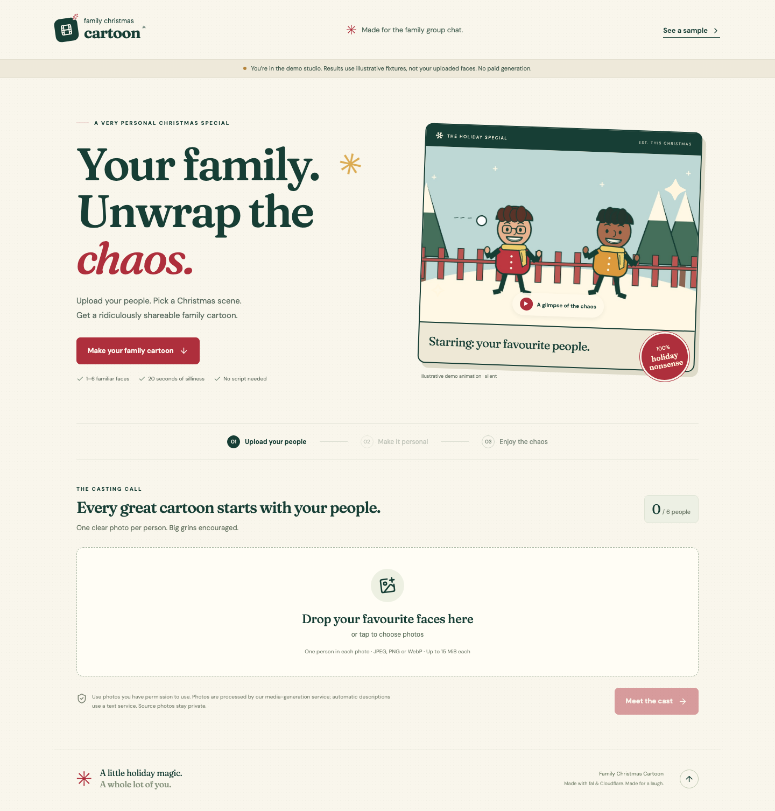

# Family Christmas Cartoon

Your people. A little holiday chaos. A mobile-first React app that turns **1–6 individual portraits** into a four-shot, 20-second holiday cartoon.

**Hosted main:** https://family-holiday-special.juelzlax.workers.dev (mock mode).

**Status:** the local and hosted mock experience works end to end, including persistent jobs, playback, sharing, and deletion. Real fal / Workers AI / Cloudflare Container adapters are implemented behind disabled production gates. The main Worker is deployed; paid model inference remains disabled on main. Generated likeness, model comparisons and the human quality pilot are still unverified. Mock results are original illustrative animations, explicitly labeled throughout the app.

The product authority is [Family_Christmas_Cartoon_PRD.md](Family_Christmas_Cartoon_PRD.md), with [Model_Selection_Decisions.md](Model_Selection_Decisions.md) alongside it. See [the implementation report](docs/IMPLEMENTATION_REPORT.md) for evidence and remaining launch inputs.

## Run locally

Requires Node 22.12+ and npm. Normal mock operation needs no API keys, Docker, Python or system FFmpeg.

```sh
npm ci
npm run db:local
npm run dev
```

Open **https://localhost:8787** and accept Wrangler's local development certificate. HTTPS is deliberate: Safari rejects the secure ownership cookie on HTTP localhost. Real deployment also requires HTTPS. The only browser persistence is the project ID; ownership stays in an HttpOnly, Secure, SameSite cookie. Returning to `/p/<project-id>` works in that browser. A share link grants playback, never ownership.

Upload JPEG, PNG or WebP portraits, confirm framing if browser detection is unavailable, add descriptions or choose them automatically, select a preset, then Generate. The mock job uses the same D1/R2/Workflow machinery as real mode and completes with a silent development fixture. **It does not create likenesses from the uploaded photos.**

`npm run build` refreshes the frontend while a Wrangler session is running. Worker changes reload automatically. The self-hosted MediaPipe WASM files are copied at install time; the versioned detector model is committed and checksum-verified. Photos are not sent to a third-party detector CDN.

## Verify

```sh
npm run check                  # TypeScript, domain/D1/security tests, Vite build
npx playwright install chromium webkit
npm run test:e2e               # API + desktop Chromium + 360px mobile WebKit
npm run test:scenarios         # Six isolated, durable Workflow failure/callback scenarios
npm run deploy:check           # Bundle and binding check; never deploys
```

Browser tests start an isolated HTTPS mock server on port 8790 with separate `.wrangler/e2e` storage and test-only mock budget/rate ceilings. They do not use production secrets, submit paid requests or post messages. Scenario tests use port 8791 and temporary storage. Do not run two copies of either suite simultaneously. Tests retain traces/screenshots under ignored `test-results/`; these can contain local fixture ownership cookies and must not be published as production diagnostics.

For native media checks or fixture rebuilding:

```sh
python3 -m venv renderer/.venv
renderer/.venv/bin/pip install -r renderer/requirements.txt
npm run test:media
npm run fixtures               # Rebuilds original, code-drawn illustrative fixtures
```

Project-local FFmpeg/ffprobe binaries are development dependencies on supported platforms; the container uses Debian FFmpeg. Override `FFMPEG_BINARY` / `FFPROBE_BINARY` if needed. Renderer tests check EXIF removal, decoded-dimension limits, all-six-person end cards, and a real 20-second H.264/AAC edit whose selected 880 Hz test audio is preserved while the generated clips' 440 Hz audio is absent. The test tones are not production music.

## Structure

| Location | Responsibility |
| --- | --- |
| `src/client` | Three-stage upload/personalize/generate flow, accessible crop controls, local detector, progress and player |
| `src/shared` | Strict Zod contracts, deterministic presets, fixed style and retention/retry policy |
| `src/server` | Hono API, secure sessions, D1/R2, fal queue and signatures, budgets, Workflows, cleanup |
| `migrations` | D1 schema, asset cleanup bookkeeping |
| `renderer` | Pillow normalization/cast composition and the single native FFmpeg render path |
| `public/fixtures` | Illustrative development assets, not model benchmark evidence |
| `scripts/check-scenarios.mjs` | Callback races, missing callbacks, selective repair, unknown submission, exhaustion and rejection checks |
| `docs` | Implementation report, continuity explanation, pilot and asset records |

## Deploy main

`wrangler.production.jsonc` targets the hosted mock Worker with its own D1/R2 bindings and HTTPS origin. Run `npm run deploy:main` after reviewing changes. The deployed signing secret is retained by Cloudflare and is not committed. Local development still uses `wrangler.jsonc`.

## Prepare real mode

`wrangler.real.jsonc` is a template, not a ready-to-launch account configuration. Docker and an appropriate Cloudflare plan are needed to build/deploy Containers. The container's build context is `renderer/`. Nothing in CI deploys it.

1. Provision a private D1 database and private R2 bucket in your intended Cloudflare account; replace the placeholder D1 ID and confirm bucket/Workflow/Container names. Set `APP_ORIGIN` to the final HTTPS origin and set a Turnstile site restricted to that hostname.
2. Apply migrations with `npx wrangler d1 migrations apply DB --remote --config wrangler.real.jsonc`. Do this only after reviewing the account and deployment plan.
3. Add secrets interactively, never in source or command arguments:

   ```sh
   npx wrangler secret put FAL_KEY --config wrangler.real.jsonc
   npx wrangler secret put ASSET_SIGNING_SECRET --config wrangler.real.jsonc
   npx wrangler secret put TURNSTILE_SECRET --config wrangler.real.jsonc
   ```

   Use a high-entropy signing secret of at least 32 random bytes. Retain it through the campaign: share tokens are derived by HMAC so Share can be idempotent while D1 stores only token hashes. Rotating it invalidates old share URLs. Set `FAL_WEBHOOK_USER_ID` to the expected fal webhook account/user ID. Keep fal model screening enabled.
4. Verify endpoint access and current input contracts, including actual account pricing. Fill **all** spending fields below, then mark `PRICE_CONFIG_VERIFIED=true`. Empty or invalid amounts disable paid calls. Model-name substitution alone is refused; implement and verify the corresponding typed adapter first.
5. Supply cleared instrumental WAV files as `music/snowball.wav`, `music/giftwrap.wav`, `music/danceoff.wav` in private R2. Record the source, license and redistribution/download rights in [MUSIC.md](docs/MUSIC.md). Add representative, real pre-generated samples as `samples/<preset>.mp4` and posters as `samples/<preset>.jpg`, for each of `snowball`, `giftwrap`, `danceoff`. Sample views never invoke models.
6. Run the permissioned cast/model comparison and human pilot in [PILOT.md](docs/PILOT.md), under an explicitly authorized spending envelope. Set `PILOT_APPROVED=true` only when the operator has authorized controlled real operation; it is not evidence that a quality benchmark passed. Keep `REVIEW_ENABLED=false` until the advisory reviewer is calibrated. Set `MUSIC_CLEARED=true` only after checking all three tracks' rights.
7. Review `PAID_GENERATION_ENABLED` before enabling it. It is the kill switch and defaults to `false`. New paid submissions, text requests and native processing all fail closed. The app is anonymous and operator funded, with one new project per session per day in real mode, plus a configurable network ceiling.
8. Run checks, then `npx wrangler deploy --config wrangler.real.jsonc --dry-run`. This builds the Docker image and requires Docker. `--containers-rollout=none --dry-run` checks the Worker bundle/bindings without building or deploying the image; it does **not** verify the container build. Actual deployment is an operator step: `npm run deploy:real`.

The default local signing key is accepted only for mock mode on localhost. A publicly hosted mock also needs its own signing secret. No public bucket or arbitrary remote-photo upload is used.

### Spending fields

All prices are **conservative envelopes**, not measured billing. The example values in mock configuration are invented test values. Real configuration deliberately leaves them empty.

| Variable | Unit |
| --- | --- |
| `MAX_JOB_COST_USD` | Total per project, including text, review, processing and retained unknown reservations |
| `DAILY_BUDGET_USD` | Total this application can reserve for the UTC account day, across sessions/projects |
| `IMAGE_COST_USD` | One configured image request including its references, size and quality |
| `VIDEO_COST_USD` | One five-second 768P H3 request including conservative reference overages |
| `TEXT_COST_USD` | One bounded description call; malformed-output repair is another reservation |
| `REVIEW_COST_USD` | One bounded advisory visual review call |
| `PROCESSING_COST_USD` | One native normalization, crop or inspection HTTP call; retries reserve again |
| `RENDER_COST_USD` | Entire bounded render envelope, including at most two render executions, internal clip checks and poster composition |
| `MAX_PROVIDER_CONCURRENCY` | Account-wide active fal slots; unknown submissions keep their slot |
| `MAX_DESCRIPTION_REQUESTS` | Description button requests per draft, initially 20 |

A single D1 statement atomically reserves spend against both ceilings. Reservations are idempotent by call/envelope ID. Unknown submissions retain reservations, and failures never trigger unlimited repair. At most two additional image attempts and one additional video attempt are allowed across a project, and a stricter money cap always wins. Fixed storage, bandwidth, database and unrelated provider-account activity are not an exact whole-account invoice cap.

## Operations and cleanup

A 15-minute scheduled handler expires abandoned drafts at 24 hours; removes intermediate media seven days after completion/failure; and retains finished video/poster/share records until the later of 30 days after completion and **2027-02-01 05:00 UTC** (the end of January 31 in Toronto). Earlier source cleanup cannot remove the final video. Deleted and expired links are checked on every media request and use no long-lived public cache.

Delete revokes the application link immediately, terminates the Workflow and attempts provider cancellation, then schedules retryable R2 deletion. It cannot recall downloads or guarantee erasure from an external provider's prior processing. Cleanup marks removed objects so later batches make progress, clears private character text after intermediate retention, and purges retired operational records after 90 days. Ownership records needed by still-active projects remain until that content retires.

A lost submission receipt remains `submission_unknown`; the app waits for a correlated signed callback and stops without duplicate submission if acceptance stays unknown. Operators should reconcile that attempt in the fal dashboard before resolving its reservation/slot. Do not create another request to discover whether the first one happened. A known request with a missing callback is polled by its original ID. Callback handlers only record durable facts and never launch inference.

The default local server can invoke cleanup with Wrangler's scheduled-test support. To reset only development data, stop local servers and remove **this repository's** ignored `.wrangler/state` and `.wrangler/e2e` directories; this loses local projects. Never run remote destructive cleanup commands based on those local instructions.

See [CONTINUITY.md](docs/CONTINUITY.md) for the tutorial-oriented technical explanation and [ASSET_PROVENANCE.md](docs/ASSET_PROVENANCE.md) for bundled media/font/model provenance.

## Preview



[360 px mobile screenshot](docs/screenshots/mobile.png)
