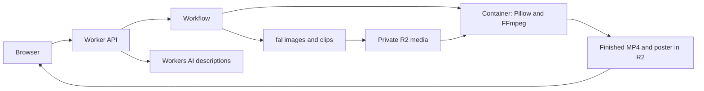

# Why there is a container

The application needs a media-processing service in addition to generative models. The current implementation runs that service in a Cloudflare Container so its Worker/Workflow can invoke FFmpeg, ffprobe and Python/Pillow in a Linux environment. This is an implementation choice, not an inherent requirement that every cartoon application use containers.

The diagram shows logical data flow. Provider results are actually copied into R2 by the Workflow's checked output-storage step; fal does not receive R2 write credentials. The Worker authorizes final playback/downloads and signs short-lived asset-scoped inference URLs. The renderer has a binding-only HTTP interface; it does not expose a public editing API.

## Work performed by each service

The Worker handles ownership, private upload tickets, cast edits, sharing and download authorization. D1 stores project state and spending reservations. The Workflow persists generation progress, limits concurrent provider submissions, handles known request IDs and controls repairs. fal generates individual cartoon portraits, four starting frames and four five-second video clips. Workers AI produces bounded character descriptions.

The container handles operations that the selected fal generation endpoints do not perform:

- Decode and normalize source photos, remove EXIF and produce reference crops with Pillow.
- Decode generated images and inspect actual clip dimensions/duration with ffprobe.
- Trim four clips to 4.5 seconds each; normalize to 1280 × 720 at 24 fps.
- Build a two-second all-cast end card and poster from the accepted portraits.
- Remove every generated clip's soundtrack, add only the selected original instrumental track and encode the final 20-second H.264/AAC MP4.

See [service.py](../renderer/service.py) for the internal HTTP contract, [media.py](../renderer/media.py) for native processing and [render.ts](../src/server/render.ts) for Worker orchestration. The temporary media files are discarded after each operation; durable media lives in private R2.

## Why this runs outside an ordinary Worker

The Python renderer uses native Linux binaries, subprocesses, codec libraries, fonts and scratch files. An ordinary Worker cannot execute this program unchanged. Cloudflare documents [Containers](https://developers.cloudflare.com/containers/) for applications requiring a specific runtime, Linux-like environment and larger CPU/memory/disk resources. Workflow durability coordinates the processing but does not supply a native execution environment itself.

There is one renderer implementation. Two bounded instances support a normalizer/inspector and final assembly; they sleep after two idle minutes. No GPU or AI model runs in the container.

## Tradeoff and alternatives

This keeps rendering deterministic and testable, gives exact control over duration/audio/codecs and keeps application infrastructure within Cloudflare. It adds an image build/deployment, cold starts and Cloudflare Container charges. Containers require the Workers Paid plan, with a $5/month minimum and usage beyond included allowances; see [current pricing](https://developers.cloudflare.com/containers/platform/pricing/).

The container could be removed by replacing normalization, inspection, poster composition and final rendering with suitable managed APIs or another hosted renderer. That would require implementing and validating those contracts, privacy controls, pricing and recovery behavior. Browser-side FFmpeg/WASM is another architectural option, but moves encoding and memory/battery load to the user's phone and needs a different persistence/recovery design. None of these alternatives has been implemented or priced for this project.
